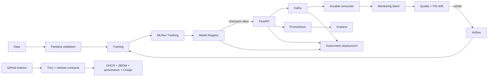

# MLOps Platform

A production-oriented MLOps reference project that implements the complete model lifecycle:
data validation, reproducible training, experiment tracking, model governance, online inference,
workflow orchestration, observability, drift detection, event streaming, Kubernetes deployment,
and secure CI/CD.

The predictive model is intentionally simple. The project is about **operational ML system
design**, not leaderboard model complexity.

## What this project demonstrates

| Capability | Implementation |
|---|---|
| Data contracts | Pandera validation, deterministic synthetic dataset, DVC lineage |
| Training | scikit-learn pipeline with reproducible configuration |
| Experiment tracking | MLflow runs, metrics, parameters, artifacts, dataset fingerprints |
| Model governance | MLflow Registry aliases, candidate/champion promotion policy |
| Serving | FastAPI, strict feature contract, health/readiness endpoints |
| Containers | Non-root Docker image and Docker Compose |
| Orchestration | Airflow training and monitoring DAGs |
| Observability | Prometheus metrics and provisioned Grafana dashboard |
| Monitoring | Data-quality gate, PSI drift detection, retraining decision policy |
| Event streaming | Kafka prediction events and durable consumer |
| Deployment | kind/Kubernetes, probes, PDB, PVCs, rolling updates |
| Security | Trivy, seccomp, capability dropping, non-root runtime |
| Supply chain | GHCR release workflow, SBOM, provenance, keyless Cosign signing |
| Automation | GitHub Actions CI/release workflows and Dependabot |

## Architecture



A more detailed view and design rationale are in
[`docs/ARCHITECTURE.md`](docs/ARCHITECTURE.md).

## Quick start on macOS

Prerequisites: Python 3.12, Docker Desktop, Homebrew, `kind`, and `kubectl`.

```bash
cd ~/PycharmProjects/mlops_platform
python3.12 -m venv .venv
source .venv/bin/activate
python -m pip install -e ".[dev]"
make quality
```

Fast deterministic local path:

```bash
make data
make train
make mlflow-smoke
make register
make registry-smoke
make predict
```

Full platform demonstration:

```bash
brew install kind kubectl trivy
make portfolio-demo
```

The full demo creates a disposable kind cluster and validates MLflow, Kafka, two-replica
FastAPI serving, durable event persistence, Prometheus, Grafana, and a zero-unavailable
rolling update.

After a successful demo:

- FastAPI: `http://127.0.0.1:8002/docs`
- MLflow: `http://127.0.0.1:5052`
- Prometheus: `http://127.0.0.1:9093`
- Grafana: `http://127.0.0.1:3002`

Clean up only the local Kubernetes demo cluster with:

```bash
make k8s-delete
```

## Release readiness

Run the complete release-package gate:

```bash
make m12-smoke
```

It verifies code quality, tests, Kubernetes manifests, security/supply-chain contracts,
strict release-version matching, and portfolio documentation completeness.

For the full runtime demonstration of the final release candidate:

```bash
make portfolio-demo
```

## Model lifecycle

1. Generate and validate a deterministic binary-classification dataset.
2. Train a `StandardScaler + LogisticRegression` pipeline.
3. Log metrics, parameters, configuration, lineage, and model artifacts to MLflow.
4. Register the model as `candidate`.
5. Promote only qualified models to the `champion` alias.
6. Load the exact champion model into FastAPI.
7. Publish versioned prediction events to Kafka.
8. Materialize production events into a monitoring batch.
9. Apply data-quality and PSI drift policies.
10. Trigger the Airflow retraining path only for valid distribution drift.
11. Expose service/model/Kafka metrics through Prometheus and Grafana.
12. Deploy the online path to Kubernetes with health probes and controlled rollouts.
13. Build, scan, attest, publish, and sign tagged release images.

## Important design choices

**Aliases instead of MLflow stages.** Deployment resolves
`models:/mlops-platform-logistic-regression@champion`; deprecated fixed stages are not used.

**Fail-open Kafka publishing for inference.** A temporary event-publishing failure does not
turn a valid prediction into an API failure. Publish status is exposed as a metric.

**Retraining is gated by data quality.** Invalid or incomplete data produces
`action=investigate`, never automatic retraining.

**At-least-once event processing with request-ID deduplication.** The consumer fsyncs the
durable JSONL log before committing Kafka offsets and deduplicates persisted request IDs.

**Local Kubernetes is intentionally disposable.** kind provides a reproducible portfolio
environment without pretending to be a managed production cluster.

See [`docs/ARCHITECTURE.md`](docs/ARCHITECTURE.md) for trade-offs and
[`docs/RUNBOOK.md`](docs/RUNBOOK.md) for failure handling.

## Repository map

```text
src/mlops_platform/      Application, training, registry, monitoring, Kafka
tests/                   Unit and contract tests
configs/                 Training/serving/monitoring/Kafka configuration
dags/                    Airflow DAGs
k8s/                     kind configuration and Kubernetes manifests
.github/workflows/       CI and signed release pipelines
scripts/                 Integration, security, demo, and release smoke tests
docs/                    Architecture, demo, operations, and publishing guides
```

## Documentation

- [`docs/ARCHITECTURE.md`](docs/ARCHITECTURE.md) — system architecture and trade-offs
- [`docs/DEMO.md`](docs/DEMO.md) — recruiter/interview demonstration flow
- [`docs/RUNBOOK.md`](docs/RUNBOOK.md) — operational diagnosis and recovery
- [`docs/PUBLISHING.md`](docs/PUBLISHING.md) — GitHub publication checklist
- [`CHANGELOG.md`](CHANGELOG.md) — milestone history
- [`SECURITY.md`](SECURITY.md) — vulnerability-reporting and supply-chain policy

## Milestones

| Milestone | Scope | Status |
|---|---|---|
| M0 | Repository foundation + deterministic baseline | done |
| M1 | Data contracts + DVC lineage | done |
| M2 | MLflow experiment tracking | done |
| M3 | Model Registry + promotion policy | done |
| M4 | FastAPI inference | done |
| M5 | Docker + Compose | done |
| M6 | Airflow orchestration | done |
| M7 | Prometheus + Grafana | done |
| M8 | Drift/data-quality monitoring + automated retraining decision | done |
| M9 | Kafka event-driven inference | done |
| M10 | Kubernetes deployment | done |
| M11 | CI/CD + security + reliability hardening | done |
| M12 | Portfolio release + architecture + demo + runbook | done |

## Release

Current release candidate: **v1.0.0**.

A `v1.0.0` Git tag triggers the release workflow, which validates the repository, scans the
container, publishes the OCI image to GHCR with SBOM/provenance, and keyless-signs the immutable
image digest with Cosign.

This snapshot intentionally does **not** choose a software license on the owner's behalf.
Select and add the desired license before making the repository public.
