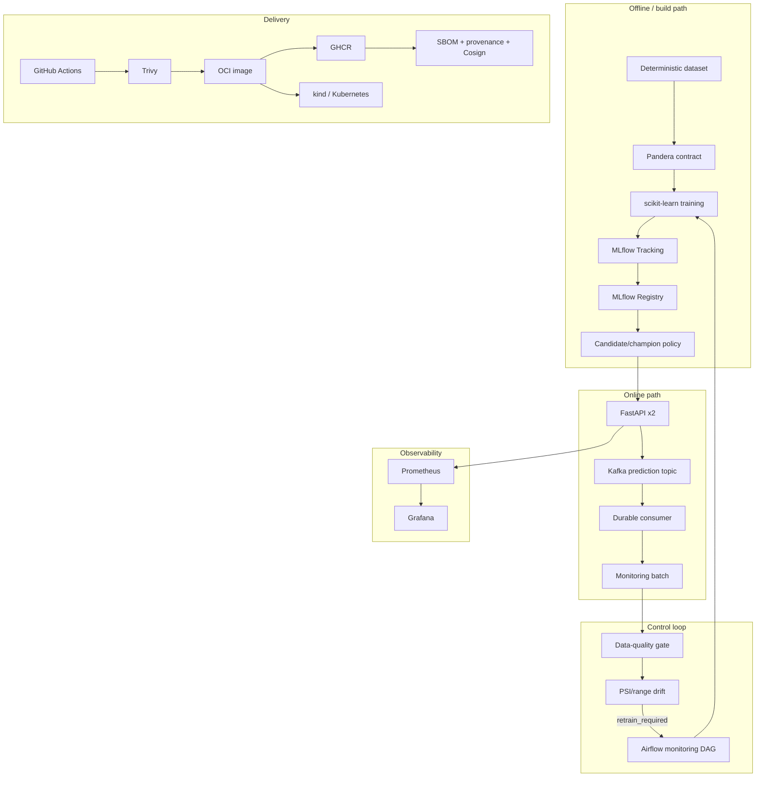

# Architecture

## Goal

`mlops-platform` is a compact reference implementation of the operational lifecycle around a
machine-learning model. The model itself is deliberately inexpensive so that local development
can focus on orchestration, lineage, governance, serving, monitoring, event processing,
deployment, and release engineering.

## Logical architecture

## Data and training

The dataset is deterministic and versionable. Pandera enforces schema and numeric constraints.
DVC records pipeline dependencies and outputs. Training logs model parameters, metrics,
configuration, dataset fingerprint, model artifact, and run metadata to MLflow.

The reference estimator is `StandardScaler + LogisticRegression`. This keeps model training
fast enough for integration tests while still exercising realistic serialization, probability
prediction, feature contracts, registry promotion, and monitoring.

## Model governance

Each training run can become a registered model version. The newest evaluated model receives the
`candidate` alias. Promotion to `champion` requires the configured minimum ROC-AUC and improvement
policy. Serving resolves the champion alias, preserving exact model-version and source-run lineage.

## Online inference and event flow

FastAPI validates the exact feature set and finite numeric values. It exposes `/health`, `/ready`,
`/v1/model-info`, `/v1/predict`, and `/metrics`.

Each successful prediction produces a versioned Kafka event containing request ID, features,
prediction, probability, threshold, model identity, source run, and dataset fingerprint.
Inference is fail-open with respect to Kafka enqueue failures: prediction availability is not
coupled to the event broker. The publish outcome is observable through Prometheus.

The Kafka consumer provides at-least-once processing semantics with application-level
request-ID deduplication. It appends events to a durable JSONL log, fsyncs before committing the
Kafka offset, and atomically materializes the latest bounded monitoring batch.

## Monitoring and retraining policy

Monitoring separates data quality from distribution drift.

- Missing required features, insufficient rows, excessive missing values, or non-finite values
  cause `action=investigate` and never automatic retraining.
- Valid batches are compared with the training reference profile using numeric PSI and
  outside-reference ratios.
- Threshold-crossing distribution drift causes `action=retrain`.
- Stable or warning-only batches cause `action=no_action`.

The Airflow monitoring DAG triggers the training workflow only when the decision contract says
`retrain_required=true`.

## Deployment modes

The project keeps several deployment modes because each demonstrates a different MLOps concern.

1. Local Python: fastest deterministic development loop.
2. Docker Compose: container/API/MLflow integration.
3. Airflow Compose: orchestration and monitoring pipelines.
4. Kafka/observability Compose overlays: event-driven and monitoring integration.
5. kind/Kubernetes: production-style online deployment semantics.

The Kubernetes demo contains persistent MLflow/Kafka/event storage, MLflow bootstrap and Kafka
topic Jobs, two API replicas, a PodDisruptionBudget, probes, requests/limits, seccomp,
non-root first-party containers, and `maxUnavailable: 0` rolling updates.

## Security and software supply chain

The application image runs as UID/GID 10001 and drops Linux capabilities. First-party Kubernetes
workloads disable automatic service-account token mounting and use `RuntimeDefault` seccomp.

CI enforces code/contracts and scans the image with Trivy. Tagged releases publish to GHCR with
BuildKit SBOM and provenance attestations and keyless-sign the immutable digest with Cosign using
GitHub OIDC.

## Intentional limitations

This is a portfolio/reference platform, not a hosted production service.

- The local MLflow deployment uses SQLite and a filesystem artifact store.
- Kafka is a single KRaft broker in the demonstration environment.
- kind is a local disposable Kubernetes cluster.
- Secrets in the local demo are demonstration credentials, not a production secret-management
  system.
- The dataset is synthetic and the estimator is intentionally simple.
- Cloud-specific IAM, managed databases, autoscaling, multi-zone Kafka, TLS ingress, and managed
  secrets are outside the scope of this repository.

These constraints are explicit so the repository demonstrates sound engineering without claiming
production characteristics that the local environment does not provide.
